# Pendahuluan

**Tujuan.** Laporan ini menjawab tiga task UTS Deep Learning: (1) klasifikasi cacat produk dari gambar dan
sinyal sensor, (2) prediksi sisa umur pakai (RUL) mesin press dari riwayat sensor per siklus, dan
(3) pengelompokan sampel material tanpa label dari citra mikrostruktur dan spektrum komposisi. Untuk setiap task,
kami membangun pipeline deep learning yang lengkap dan jujur: eksplorasi data, desain arsitektur, validasi yang
bebas kebocoran, analisis ketangguhan atau ketidakpastian, dan prediksi untuk data uji.

**Data** (`docs/kamus_data.md`, tanpa data eksternal):

| Task | Data latih | Data uji / evaluasi | Metrik di data tersembunyi |
|---|---|---|---|
| 1. Klasifikasi multimodal | 48.000 unit: gambar 64×64 + sinyal 3 kanal × 128, 7 kelas | 16.000 unit | macro-F1 |
| 2. RUL | 900 mesin, riwayat sampai rusak (254.174 siklus) | 300 mesin, terpotong sebelum rusak | RMSE + skor asimetris |
| 3. Clustering multimodal | 36.000 sampel: citra 64×64 + spektrum 128 titik, tanpa label | sampel yang sama | ARI |

**Ringkasan pendekatan.**

- **Task 1**: encoder CNN (gambar) dan 1D-CNN (sinyal) dengan tiga strategi fusi. *Cross-attention* adalah yang
  terbaik. Eksperimen pendukung: nilai tiap modalitas, deteksi label salah lewat prediksi out-of-fold, pengukuran
  domain shift per lini produksi, dan *modality dropout* agar model tetap masuk akal saat sensor hilang.
- **Task 2**: normalisasi per regime operasi, penanganan spike dan NaN yang kausal, label RUL dengan cap 150, dan
  sliding window kausal. GRU, TCN, dan Transformer dibandingkan dengan baseline LightGBM dalam validasi silang per
  mesin. Interval prediksi berasal dari ensemble dan MC dropout yang dikalibrasi dengan *split-conformal*, lalu
  dipakai untuk aturan servis.
- **Task 3**: representasi tanpa label dengan SimCLR. Augmentasinya dirancang dari distorsi yang ditemukan saat
  eksplorasi. Embedding citra dan spektrum difusi, lalu K-Means, GMM, dan DEC dibandingkan. Jumlah cluster
  ditentukan dengan beberapa kriteria.

**Reproduksibilitas dan konvensi angka.** Setiap angka di laporan berasal dari `runs/<run>/metrics.json` yang
dihasilkan kode. File sumbernya disebut di teks, dan tabel lengkapnya ada di `docs/tabel_laporan.md`, yang dibuat
otomatis oleh `kode/tabel_laporan.py`. Semua angka dapat dihitung ulang dengan
`python kode/reproduce.py --data data_uts_dl --task all`. Mode cepatnya memakai weights final di `weights/`,
sedangkan `--retrain` melatih ulang semuanya. Seed dan versi library disimpan di `config.json` setiap run.
Training dilakukan dengan Python 3.12.10, PyTorch 2.14.1 (CUDA 12.6), dan GPU RTX 3050 Laptop 4 GB
(`kode/requirements.txt`). Angka desimal ditulis dengan koma.

# Task 1 — Klasifikasi Multimodal Cacat Produk

Penulis bab: Satrio Arjuna Putra. Semua angka berasal dari `runs/<run>/metrics.json` (tabel lengkap:
`docs/tabel_laporan.md`, dibuat otomatis oleh `kode/tabel_laporan.py`). Validasi = 9.600 unit (20%,
stratified per kelas × lini, seed split tetap 0) sehingga semua eksperimen dibandingkan di himpunan yang sama.

## 1a. Eksplorasi

Data latih 48.000 unit dan data uji 16.000 unit; tiap unit punya gambar grayscale 64×64 dan sinyal
sensor 3 kanal (suhu, getaran, arus) × 128 titik (`runs/t1_eda/metrics.json`, Gambar
`laporan_figs/task1/eda_contoh_gambar.png`, `eda_sinyal_per_kelas.png`).

- **Kelas tidak seimbang** (`eda_distribusi.png`): normal 23.888 unit (49,8%), kontaminasi hanya
  2.357 (4,9%). Karena itu loss memakai bobot kelas 1/√frekuensi dan metrik utama macro-F1.
- **Sensor hilang per kanal secara utuh**: tidak ada kanal yang hilang sebagian (fraksi 0,0). Tiap kanal
  hilang ±5,9%; 4,9% unit latih kehilangan ketiga kanal (test 5,1%). Persentasenya merata antar kelas
  (4,2–5,6%) dan antar lini, jadi hilangnya sensor tidak membocorkan label. Masukan sensor diberi
  3 kanal mask (1 = terekam) dan NaN diisi 0 setelah normalisasi.
- **Sinyal per kelas**: selisih rata-rata sinyal terhadap kelas normal (dalam satuan std) besar hanya
  untuk `las_dingin` pada arus (2,84) dan `gelembung` pada suhu (0,25); kelas lain < 0,04. `retak` sedikit
  menaikkan std getaran (0,805 vs ±0,786). Dugaan awal: `las_dingin` butuh sensor, kelas lain butuh gambar.
- **Perbedaan train–test per lini** (`eda_shift_lini.png`): lini B hanya 25,1% data latih tetapi
  60,0% data uji (mesin M07–M12 muncul ±2,4× lebih sering di test). Gambar lini B lebih gelap
  (kecerahan rata-rata 111,7 vs 139,8) dan kontrasnya lebih tinggi (17,1 vs 12,8); suhu lini B ±2 °C lebih
  tinggi. Distribusi kelas per lini hampir sama, jadi pergeserannya ada di *input* (covariate shift), bukan di label.
  Akibatnya skor validasi biasa (75% lini A) terlalu optimis untuk data uji; kami juga melaporkan
  **macro-F1 tertimbang komposisi test** (sampel validasi diberi bobot p_test(lini)/p_train(lini)).
  Bobot ini hanya memakai atribut `lini` di meta test, tanpa label.

## 1b. Arsitektur (`kode/task1_klasifikasi/task1_model.py`)

- **Encoder gambar**: CNN 4 blok (2× conv3×3-BN-ReLU + maxpool), 64×64 → 4×4×256. Cacat adalah pola
  lokal, sehingga bias induktif CNN cocok; dilatih dari nol (tanpa data/bobot eksternal).
- **Encoder sinyal**: 1D-CNN 4 blok (kernel 5), masukan 6 kanal (3 nilai + 3 mask), 128 → 8 token × 256.
- **Tiga strategi fusi** (dibandingkan pada konfigurasi training identik, 25 epoch, AdamW + OneCycle):
    1. *concat* (intermediate fusion): [v_gambar, v_sensor × ada, mask] → MLP.
    2. *late*: kepala klasifikasi terpisah; logit = l_gambar + a_k · ada · l_sensor (a_k per kelas dipelajari).
    3. *xattn*: cross-attention dua arah antara 16 token gambar dan 8 token sinyal, plus satu token
     "kosong" yang dipelajari agar attention tetap terdefinisi saat sensor hilang.

| Model (validasi) | Param | Macro-F1 | Lini A | Lini B | Tertimbang test |
|---|---|---|---|---|---|
| gambar saja | 1,24 jt | 0,687 | 0,721 | 0,584 | 0,639 |
| sensor saja | 0,72 jt | 0,458 | 0,471 | 0,417 | 0,439 |
| fusi concat | 1,96 jt | 0,837 | 0,870 | 0,736 | 0,790 |
| fusi late | 1,96 jt | 0,830 | 0,862 | 0,729 | 0,784 |
| **fusi xattn** | 2,49 jt | **0,844** | **0,873** | **0,754** | **0,803** |

Cross-attention terbaik di semua kolom, terutama di lini B (+0,018 dari concat), sehingga dipakai sebagai
dasar eksperimen 1d–1g. Selisih antar fusi kecil (≤ 0,014), jadi kesimpulan "xattn > concat" perlu
dibaca bersama variasi antar seed di 1g.

## 1c. Nilai tiap modalitas (Gambar `laporan_figs/task1/modality_f1_heatmap.png`)

| F1 per kelas | normal | gores | noda | retak | gelembung | las_dingin | kontaminasi |
|---|---|---|---|---|---|---|---|
| gambar saja | 0,854 | 0,769 | 0,881 | 0,650 | 0,716 | **0,000** | 0,941 |
| sensor saja | 0,653 | 0,107 | 0,097 | 0,608 | 0,736 | **0,929** | 0,074 |
| fusi xattn | 0,908 | 0,773 | 0,877 | 0,689 | 0,790 | 0,936 | 0,933 |

- **Hanya sensor**: `las_dingin` (F1 gambar 0,000 vs sensor 0,929), sesuai EDA (plateau arus lebih rendah).
- **Hanya gambar**: `kontaminasi`, `noda`, `gores` (F1 sensor ≤ 0,11).
- **Samar di keduanya**: `gelembung` (0,716 / 0,736 → fusi 0,790) dan `retak` (0,650 / 0,608 → fusi 0,689);
  di dua kelas ini fusi memberi kenaikan terbesar karena tiap modalitas membawa informasi sebagian.
- `normal` naik dari 0,854 (gambar) ke 0,908 (fusi) karena sensor membantu menolak `las_dingin`.

<figure>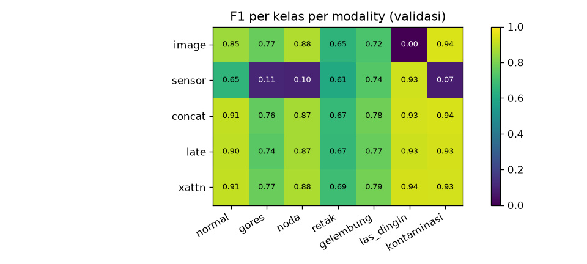<figcaption><b>Gambar 1.</b> F1 per kelas untuk model gambar saja, sensor saja, dan fusi. (<code>laporan_figs/task1/modality_f1_heatmap.png</code>)</figcaption></figure>

## 1d. Label tidak sempurna

**Deteksi.** Prediksi out-of-fold 5-fold (StratifiedKFold per kelas×lini, model xattn 15 epoch,
modality dropout 0,1; `kode/task1_klasifikasi/task1_noise.py`) memberi macro-F1 OOF 0,865. Sampel ditandai *kemungkinan salah label* bila
p(label tercatat) < 0,05 sementara model > 0,80 yakin pada kelas lain: **1.241 unit (2,6%)**
(`runs/t1_noise/mungkin_salah_label.csv`, contoh gambar `laporan_figs/task1/noise_contoh.png`,
matriks `noise_matriks.png`). Proporsi per lini (980 A / 261 B) sebanding dengan komposisi latih.

Pasangan terbanyak (label → prediksi OOF): normal→las_dingin 161, retak→normal 131, gores→normal 121,
gelembung→noda 121, noda→gelembung 107, retak→gores 104, gores→retak 95, las_dingin→normal 92.
Dua pola terlihat: (1) **normal ↔ las_dingin** — cacat yang hanya terlihat di sensor arus; inspektur yang
menilai secara visual wajar melewatkannya; (2) pasangan simetris **gelembung ↔ noda** dan **retak ↔ gores**
— kelas yang mirip secara visual, sehingga sebagian kasus lebih tepat disebut ambigu daripada salah tulis.

**Teknik tahan noise** (xattn, konfigurasi lain identik; sampel hanya dibuang dari data *latih*,
himpunan validasi tidak diubah). Dari 1.241 kandidat, **960 berada di bagian latih dan dibuang**; 281 berada di
bagian validasi dan tetap dipakai apa adanya (`runs/t1_noise/metrics.json`). Catatan: model OOF dilatih dengan
5-fold atas seluruh data latih, termasuk sampel yang kemudian menjadi validasi. Validasi tidak pernah diubah dan
model final tidak pernah dilatih padanya, tetapi daftar kandidat secara tidak langsung ikut dipengaruhi label
validasi; pengaruh ini kami anggap kecil, dan versi yang sepenuhnya bersih adalah menjalankan OOF hanya di bagian latih.

| Run | Macro-F1 | Lini A | Lini B | Tertimbang test |
|---|---|---|---|---|
| baseline | 0,8440 | 0,8731 | 0,7539 | 0,8025 |
| label smoothing 0,1 | 0,8436 | 0,8726 | 0,7561 | 0,8030 |
| buang 960 kandidat salah label (bagian latih) | **0,8521** | **0,8827** | **0,7593** | **0,8091** |

Label smoothing tidak mengubah skor; membuang kandidat salah label menaikkan macro-F1 +0,008. Catatan
jujur: label validasi juga berasal dari inspektur (ikut noisy), dan ini hasil satu seed, sehingga kenaikan
diuji ulang dengan 3 seed pada model final (1g).

## 1e. Domain shift

**Pengukuran per lini.** Pada model xattn, macro-F1 lini A 0,873 tetapi lini B hanya 0,754. F1 per kelas
per lini (`runs/t1_tabel/f1_per_kelas_per_lini.csv`) menunjukkan penurunan terpusat pada cacat **visual
yang tipis**: gores 0,832 → 0,588, retak 0,750 → 0,492, noda 0,915 → 0,768, sedangkan kelas yang dikenali
dari sensor stabil (las_dingin 0,939 → 0,928).

**Mengapa.** Analisis Fourier 2.000 gambar `normal` data latih per lini (`kode/task1_klasifikasi/task1_tekstur.py`,
`runs/t1_tekstur/metrics.json`, Gambar `laporan_figs/task1/domain_fourier.png`) menunjukkan gambar lini B
punya energi tambahan pada cincin frekuensi 13–18 siklus/64 px (periode ±4 px): median porsi energi cincin
9,8% vs 2,2% di lini A (energi absolut 27,1 vs 3,1). Di dalam satu gambar lini B, 65% energi cincin berada
dalam ±20° dari arah puncaknya (lini A 27%, mendekati merata), tetapi arah puncak itu tersebar merata antar
gambar (histogram 6 bin 0–180°: 375/365/292/357/301/310). Jadi gambar lini B memuat **garis halus berarah
dengan arah acak per gambar** — pola yang mirip goresan dan retakan tipis, sehingga menyamarkan keduanya. Kecerahan (111,7 vs 139,8) dan kontras berbeda juga, tetapi itu mudah dinormalisasi.

**Teknik yang diuji** (xattn, satu seed, validasi sama):

| Run | Macro-F1 | Lini A | Lini B | Tertimbang test |
|---|---|---|---|---|
| baseline | 0,8440 | 0,8731 | **0,7539** | **0,8025** |
| normalisasi per lini (statistik latih per lini) | 0,8402 | 0,8720 | 0,7439 | 0,7955 |
| augmentasi fotometrik + offset suhu | 0,8462 | 0,8798 | 0,7439 | 0,7988 |
| bobot ulang lini (p_test/p_train) | 0,8380 | 0,8674 | 0,7490 | 0,7967 |
| per lini + augmentasi | 0,8371 | 0,8717 | 0,7329 | 0,7886 |
| augmentasi garis halus lini B (p = 0,5) | 0,8379 | 0,8677 | 0,7469 | 0,7958 |

Empat teknik pertama hanya menyamakan kecerahan, kontras, suhu, atau bobot, sehingga tidak menyentuh
penyebab utama (garis halus); tidak satu pun menaikkan lini B. Teknik terakhir dirancang dari analisis
Fourier di atas: noise yang disaring ke cincin frekuensi yang sama dan ke irisan arah (Gaussian sd 22°)
di sekitar arah acak per gambar ditambahkan ke 50% gambar latih, dengan kekuatan disetel dari selisih
energi cincin lini B − A di data latih (tambahan std ±4,8 piksel). Garis tiruan ini meniru lini B pada
ketiga ukuran (`runs/t1_tekstur`, kolom "lini A + garis tiruan"; contoh visual di `domain_fourier.png`).
Tujuannya agar model belajar mengenali goresan/retakan meskipun tertimpa garis halus lini B.

**Hasil jujur: tidak ada teknik domain yang menaikkan lini B.** Augmentasi garis halus pun menurunkan lini B
(0,7469 vs 0,7539). Dugaan kami: menambah garis tiruan membuat gambar lini A ikut lebih sulit tanpa mengajari
model cara membedakan garis lini B dari goresan asli, karena keduanya memang mirip di skala 64×64. Karena itu
tidak ada teknik domain yang dipakai di model final. Yang ternyata menaikkan lini B adalah modality dropout
(1f: lini B 0,7539 → 0,7824), yang memaksa cabang gambar belajar lebih kuat. Sisa celah lini A–B tetap
menjadi keterbatasan utama model untuk data uji (60% lini B).

<figure>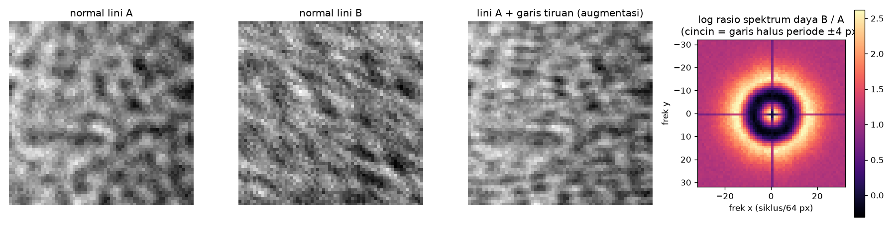<figcaption><b>Gambar 2.</b> Analisis Fourier gambar lini A vs lini B dan garis tiruan. (<code>laporan_figs/task1/domain_fourier.png</code>)</figcaption></figure>

## 1f. Modalitas hilang

Pada model fusi yang dilatih tanpa modality dropout, menghapus semua sensor di validasi menurunkan
macro-F1 xattn dari 0,844 ke 0,616 — **lebih rendah daripada model gambar saja (0,687)**, padahal
batas atas tanpa sensor kira-kira setara model gambar saja (`las_dingin` mustahil dikenali). Jadi model
fusi biasa belum "masuk akal" saat sensor tidak terekam: ia terlalu bergantung pada sensor.

**Modality dropout** (`--mod_drop 0.25`): saat training, seluruh sensor sebuah unit dihapus (mask = 0) dengan
peluang 25%, dan satu kanal dihapus dengan peluang 5%. Sensor yang dihapus benar-benar tidak terlihat
model: di encoder sinyal nilai dikalikan mask, dan cabang sensor tiap fusi dimatikan bila tidak ada kanal.

| Run (xattn, validasi) | Macro-F1 | Lini A | Lini B | Tertimbang test | Tanpa sensor (semua dihapus) | Sensor hilang asli (476 unit) |
|---|---|---|---|---|---|---|
| baseline | 0,8440 | 0,8731 | 0,7539 | 0,8025 | 0,6164 | 0,6217 |
| modality dropout 25% | **0,8692** | **0,8969** | **0,7824** | **0,8295** | **0,6705** | **0,6841** |
| (acuan) model gambar saja | 0,6872 | 0,7210 | 0,5835 | 0,6394 | 0,6872 | 0,6881 |

Tanpa sensor, model dengan modality dropout mendekati model khusus gambar (0,671 vs 0,687) — batas atas
yang wajar karena `las_dingin` hanya terlihat di sensor — jadi prediksinya kini masuk akal saat sensor hilang.
Yang tidak diduga: dengan sensor lengkap pun macro-F1 naik 0,025 dan lini B naik 0,029. Karena sensor sering
"dimatikan", cabang gambar dipaksa belajar sendiri, sehingga cacat visual ikut membaik (lini B: gores
0,588 → 0,614, retak 0,492 → 0,578; `runs/t1_tabel/f1_per_kelas_per_lini.csv`). Modality dropout 25% dipakai
di model final.

## 1g. Training dan model final

- **Sanity check**: model fusi xattn yang sama dengan model final dilatih pada satu batch 64 sampel;
  setelah 300 langkah loss turun dari 1,96 ke 5,6·10⁻⁵ dan akurasi 1,000 (`runs/t1_sanity_overfit/metrics.json`
  dan `history.json`, kurva `runs/t1_sanity_overfit/kurva_overfit.png`), menandakan pipeline data–model–loss benar dan model cukup kapasitasnya.
- Model yang dievaluasi selalu model **epoch terakhir** (jadwal OneCycle), bukan epoch terbaik di validasi,
  agar skor validasi tidak bias oleh pemilihan epoch.
- **Konfigurasi final** (dipilih di validasi dengan aturan yang ditetapkan sebelum melihat hasil: macro-F1
  tertimbang komposisi test): fusi xattn + buang 960 kandidat salah label di bagian latih (1d) + modality dropout 25% (1f);
  tidak ada teknik domain (1e) karena tidak satu pun menaikkan skor tertimbang. 25 epoch, AdamW (lr 2·10⁻³,
  wd 5·10⁻⁴), OneCycle, batch 256; dilatih dengan **3 seed (0, 1, 2)** pada split validasi yang sama.

| Model final, validasi (`runs/t1_tabel/final_mean_std.csv`) | mean ± std (3 seed) |
|---|---|
| macro-F1 | **0,8700 ± 0,0012** |
| macro-F1 lini A / lini B | 0,8992 ± 0,0022 / 0,7798 ± 0,0031 |
| macro-F1 tertimbang komposisi test (60% lini B) | 0,8286 ± 0,0015 |
| macro-F1 tanpa sensor (semua sensor dihapus) | 0,6704 ± 0,0023 |
| F1 normal / gores / noda / retak | 0,922 / 0,811 / 0,886 / 0,749 |
| F1 gelembung / las_dingin / kontaminasi | 0,837 / 0,941 / 0,944 |

- **Variasi antar seed kecil** (std macro-F1 0,0012), jadi selisih antar eksperimen satu-seed di 1b–1f yang
  lebih kecil dari ±0,003 sebaiknya dibaca sebagai setara. Contohnya, menambah "buang kandidat salah label" di
  atas modality dropout tidak menambah skor (seed 0: 0,8687 vs modality dropout saja 0,8692).
- **Kurva pembelajaran** (`laporan_figs/task1/final_kurva.png`): loss validasi bergejolak di 5 epoch awal
  (fase learning rate tinggi OneCycle), lalu stabil di ±0,5 sementara loss latih terus turun ke ±0,26; macro-F1
  validasi naik stabil dan mendatar di ±0,87 sejak epoch ±18, tanpa tanda overfitting yang menurunkan skor.
- **Confusion matrix** (`final_confusion.png`, dijumlah atas 3 seed): kesalahan terbesar adalah cacat yang
  diprediksi `normal` (terutama retak dan gores) dan retak ↔ gores — kelas yang sama dengan pasangan kandidat
  salah label di 1d dan kelas yang paling terdampak lini B di 1e.
- **Prediksi data uji**: rata-rata probabilitas 3 seed (ensemble) → `prediksi_klasifikasi.csv`
  (16.000 baris; lolos `kode/cek_submission.py --data data_uts_dl`: kolom, nama kelas, dan himpunan ID persis).

**Ringkasan Task 1.** Fusi cross-attention + modality dropout memberi macro-F1 validasi 0,870 ± 0,001. Kelemahan
utama ada di lini B (0,780), yang mendominasi data uji; garis halus lini B mirip goresan/retakan dan belum
teratasi oleh teknik domain yang kami uji, sehingga skor uji kemungkinan lebih dekat ke estimasi tertimbang
(±0,83) daripada skor validasi biasa.

<figure>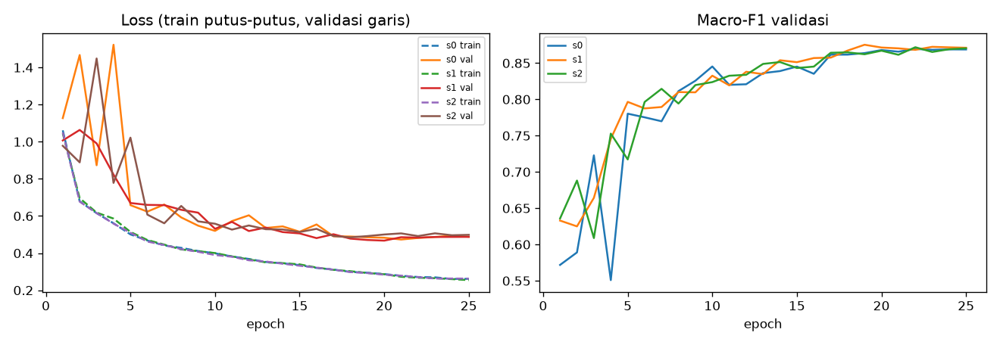<figcaption><b>Gambar 3.</b> Kurva pembelajaran model final (3 seed). (<code>laporan_figs/task1/final_kurva.png</code>)</figcaption></figure>

# Task 2 — Prediksi Remaining Useful Life (RUL) Mesin Press

Penulis bab: M Marcheliano Taji Suryana. Semua angka berasal dari `runs/<run>/metrics.json` (tabel model:
`runs/t2_tabel/model.csv`; tabel lengkap: `docs/tabel_laporan.md`). Kode di `kode/task2_rul/`.
Evaluasi utama memakai **titik potong**: untuk tiap mesin validasi diambil 5 siklus acak (siklus ≥ 50),
dan RUL diprediksi dari window yang berakhir di siklus itu. Cara ini meniru data uji, yang berhenti di
titik acak sebelum rusak dengan riwayat minimal 50 siklus (`task2_prep.titik_potong`).

## 2a. Eksplorasi dan preprocessing (`task2_eda.py`, `task2_prep.py`)

Data latih berisi 900 mesin (254.174 baris) dan data uji 300 mesin (51.692 baris). Panjang riwayat latih
rata-rata 282,4 siklus (min 133, median 265, maks 778). Riwayat uji lebih pendek, rata-rata 172,3
(min 50, median 162,5, maks 455). Nomor siklus berurutan tanpa lubang
(`runs/t2_eda/metrics.json`, Gambar `laporan_figs/task2/eda_panjang.png`, `eda_contoh_mesin.png`).

- **Setelan operasi → 6 regime** (`eda_regime.png`). `setel_1` hanya bernilai di sekitar
  {0, 10, 20, 25, 35, 42}, dan `setel_2`/`setel_3` ikut ditentukan olehnya. Simpangan baku setelan di dalam
  satu regime hanya 0,002. Jumlah baris per regime merata (42.078–42.640). Regime menggeser level sensor jauh
  lebih besar daripada degradasi: rasio std global terhadap std di dalam regime mencapai 38,8 untuk s21 dan
  21,1 untuk s19 (`runs/t2_eda/sensor.csv`).
- **Normalisasi per regime**: z = (x − μ_regime) / σ_regime, dengan μ dan σ dihitung dari **data latih saja**.
  Saat validasi silang, keduanya dihitung ulang dari fold latih (`Prep.fit`). Setelah normalisasi, tren
  degradasi baru tampak. Korelasi s04 dengan RUL naik dari −0,30 (mentah) ke −0,80, s21 dari 0,006 ke 0,34,
  dan s20 dari 0,04 ke 0,39 (`sensor.csv`). Min-max global tidak dipakai karena akan mencampur efek regime
  dengan efek degradasi. Indeks regime juga dimasukkan sebagai fitur one-hot (6 kanal).
- **Sensor tak informatif**: s01, s05, s06, s10, s16, s18, dan s19 hampir tidak berkorelasi dengan RUL
  setelah normalisasi per regime (|r| ≤ 0,005, `sensor.csv`), jadi dibuang. Tersisa 14 sensor.
- **Nilai hilang**: rata-rata ±2,0% per sensor, tersebar acak. Akibatnya 35,0% baris punya minimal satu NaN,
  sehingga membuang baris bukan pilihan. NaN diisi dengan *forward-fill* di dalam mesin yang sama (hanya nilai
  masa lalu). Sisa NaN di awal riwayat diisi 0, yaitu rata-rata regime.
- **Spike**: sebuah nilai dianggap spike bila menyimpang > 3 (satuan z) dari median 5 siklus
  **sebelumnya**, lalu diganti dengan median itu. Aturannya kausal, sehingga perlakuannya identik pada data
  uji yang terpotong dan tidak memakai masa depan. Di data latih penuh ada 5.199 spike yang diganti dan
  72.200 NaN yang diisi (`runs/t2_eda/metrics.json` → `preprocessing_train`).

Fitur per siklus = 14 sensor + siklus/200 + one-hot regime (6) = 21 kanal, ditambah 1 kanal mask.

<figure>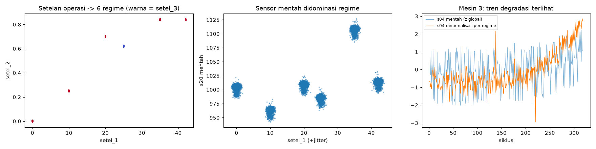<figcaption><b>Gambar 4.</b> Setelan operasi membentuk 6 regime; normalisasi per regime memperlihatkan tren degradasi. (<code>laporan_figs/task2/eda_regime.png</code>)</figcaption></figure>

## 2b. Label (`task2_prep.label_rul`)

Di data latih, siklus terakhir tiap mesin adalah siklus saat rusak, sehingga
RUL(t) = min(150, siklus_terakhir − t). Cap 150 mengikuti aturan soal dan juga masuk akal secara fisik: di
awal umur, mesin belum menunjukkan degradasi, sehingga RUL 300 dan RUL 200 tidak dapat dibedakan dari sensor.
Model memprediksi RUL/150. Saat evaluasi dan prediksi, keluaran di-*clip* ke [0, 150].

## 2c. Sekuens (`task2_prep.Jendela`)

Window panjang W yang berakhir di siklus t berisi siklus t−W+1 … t, jadi **tidak pernah memuat siklus
sesudah t**. Riwayat yang lebih pendek dari W diberi padding nol di **kiri**, dan kanal mask bernilai 0 di
bagian padding (1 = data asli). Model bisa membedakan padding dari bacaan asli tanpa perlu mengintip masa
depan. Satu window dibuat untuk setiap siklus setiap mesin latih. Window disimpan sekali per mesin dan
diambil lewat indeks, bukan disalin per sampel, sehingga hemat memori. Untuk data uji, prediksi dibuat dari
window yang berakhir di siklus terakhir tiap mesin (`baris_terakhir`).

## 2d. Model (`task2_model.py`, `task2_train.py`)

| Model | Arsitektur |
|---|---|
| **GRU** | GRU 2 lapis (hidden 64) → status di siklus terakhir → MLP (64→32→1). Kausal secara alami. |
| **TCN** | Konvolusi 1D kausal ber-dilasi (1, 2, 4, 8), kernel 3, residual, 64 kanal. Receptive field 61 ≥ W. |
| **Transformer** | Encoder 2 lapis (d = 64, 4 head, pre-norm), positional embedding dipelajari, padding di-mask. Token siklus terakhir sebagai ringkasan. |
| LightGBM (baseline non-DL) | Ringkasan window per sensor: nilai terakhir, rata-rata, std, kemiringan (hanya siklus asli), + siklus, regime, panjang riwayat. 600 pohon. |

Semua model DL memakai dropout (syarat MC dropout di 2f), loss MSE, AdamW + OneCycle, clip gradien 1,0,
dan batch 512. Model yang dievaluasi adalah model **epoch terakhir**, tanpa pemilihan epoch di validasi.

**Tuning resep** dilakukan di fold 0 saja (`runs/t2_tune_*`, RMSE titik potong). Resep GRU awal (W 30,
25 epoch, lr 2·10⁻³, tanpa noise) memberi RMSE validasi 24,19 di CV 5 fold (`runs/t2_cv_gru_awal`),
padahal train RMSE di epoch terakhir hanya 9,8–10,4 (`history.json`). Resep ini jelas overfit. Resep A (W 50, 15 epoch, dropout 0,3, wd 10⁻³, noise input 0,3) memberi
22,10. Resep C (25 epoch, noise 0,5) memberi 22,09. W 80 (resep A) justru memburuk menjadi 23,20. Resep **E**
(W 50, **10 epoch, lr 10⁻³**, dropout 0,3, wd 10⁻³, noise Gaussian 0,3 pada kanal sensor asli) memberi
**19,89** dan dipakai **sama untuk ketiga arsitektur** agar perbandingan adil. Pada resep A/B, TCN mendapat
21,00/22,02 dan Transformer 22,09/23,16. Dengan resep final, train RMSE GRU di epoch terakhir 18,6–20,1
(fold 0–1, `runs/t2_cv_gru/history.json`; noise augmentasi ikut menaikkannya), dekat dengan RMSE validasi,
sehingga tidak ada celah overfitting yang besar. Jadi pelajaran utamanya: pada data ini, regularisasi kuat dan
training singkat lebih penting daripada kapasitas model.

## 2e. Validasi per mesin (GroupKFold 5 fold)

Split memakai `GroupKFold` dengan grup = `id_unit`. Semua siklus satu mesin berada di fold yang sama,
sehingga model tidak pernah melihat mesin validasi. Split per baris akan bocor karena baris-baris yang
berdekatan dari satu mesin hampir identik. Skor asimetris dihitung dengan d = prediksi − aktual:
e^(−d/13) − 1 bila d < 0 (terlalu cepat) dan e^(d/10) − 1 bila d ≥ 0 (terlambat). Prediksi yang terlalu optimis
dihukum lebih berat karena mesin bisa rusak sebelum diservis. Total ada 4.500 titik potong (900 mesin × 5):
1.076 dengan RUL aktual 0–50, 1.052 dengan 50–100, dan 2.372 dengan 100–150.

| Model (`runs/t2_tabel/model.csv`) | RMSE | RMSE per fold (mean ± std) | Skor total | Skor / titik | RMSE 0–50 | RMSE 50–100 | RMSE 100–150 |
|---|---|---|---|---|---|---|---|
| **GRU, W 50** | **19,54** | 19,53 ± 0,71 | **97.210** | **21,60** | 11,95 | 29,50 | 16,53 |
| GRU, W 30 | 19,89 | 19,88 ± 0,75 | 103.599 | 23,02 | 12,70 | 30,20 | 16,53 |
| Transformer, W 50 | 19,80 | 19,80 ± 0,47 | 119.409 | 26,54 | **11,15** | 29,50 | 17,37 |
| TCN, W 50 | 20,65 | 20,62 ± 1,25 | 102.579 | 22,80 | 19,10 | **29,32** | **16,21** |
| LightGBM, W 30 | 20,17 | 20,16 ± 0,74 | 121.527 | 27,01 | 12,89 | 30,99 | 16,44 |
| LightGBM, W 50 | 20,13 | 20,12 ± 0,72 | 115.158 | 25,59 | 12,64 | 30,77 | 16,63 |
| LightGBM, W 80 (`runs/t2_cv_lgbm_W80`) | 20,82 | 20,81 ± 0,92 | 124.347 | 27,63 | 13,70 | 31,61 | 17,15 |
| GRU awal, sebelum tuning | 24,19 | 24,18 ± 0,93 | 271.342 | 60,30 | 15,11 | 34,43 | 21,93 |

- **GRU W 50 terbaik di kedua metrik**, sehingga dipilih sebagai model final. Selisih RMSE-nya dengan
  Transformer (0,26) lebih kecil dari std antar fold (±0,5–0,7), jadi dari sisi RMSE keduanya setara. Namun skor
  asimetris GRU 19% lebih rendah, dan GRU ±3,5× lebih cepat (419 vs 1.483 detik untuk 5 fold).
- **Dibanding baseline LightGBM**, keunggulan DL dalam RMSE kecil. GRU dan Transformer lebih baik
  (19,54 dan 19,80 vs LightGBM terbaik 20,13), sedangkan TCN sedikit lebih buruk (20,65). Perbedaan yang lebih
  jelas ada di skor asimetris: GRU dan TCN (97.210 dan 102.579) jauh di bawah LightGBM (115.158–124.347),
  sementara Transformer (119.409) setara dengan LightGBM.
- **Window 50 > 30** untuk GRU (19,54 vs 19,89) dan LightGBM (20,13 vs 20,17). W 80 memburuk untuk keduanya
  (LightGBM 20,82; GRU 23,20 di tuning fold 0).
- **Rentang 50–100 adalah titik lemah semua model.** RMSE-nya ±29–31, sementara rentang 0–50 hanya ±11–13
  (TCN pengecualian dengan 19,10). Untuk GRU, 83% skor asimetris (80.394 dari 97.210) berasal dari rentang ini.
  Dugaan kami: label dipotong di 150, sementara awal degradasi tiap mesin berbeda-beda. Mesin yang baru masuk
  fase degradasi sering masih diprediksi mendekati 150 (terlambat, hukuman eksponensial). Pola ini terlihat di
  `uncert_kalibrasi.png`: banyak titik dengan RUL aktual 50–100 diprediksi di atas garis diagonal. Di rentang
  0–50, sinyal degradasi sudah jelas dan prediksi akurat.
- TCN paling buruk di 0–50 (RMSE 19,10, skor 14.102). Model ini paling kurang stabil antar fold (std 1,25).

## 2f. Ketidakpastian dan kapan servis (`task2_eksperimen.py --grup uncert`)

Eksperimen dilakukan di fold 0 (180 mesin validasi, 900 titik potong). Ada 5 GRU (seed 0–4, resep final)
dan tiap model diprediksi 30 kali dengan **MC dropout** (dropout tetap aktif saat inferensi). Prediksi gabungan
memakai μ = rata-rata μᵢ, dengan varians = varians MC dropout + varians antar-seed (ensemble). Ensemble
5 seed menurunkan RMSE dari 20,05 (seed 0) ke 19,73 dan skor dari 18.930 ke 18.609
(`runs/t2_uncert_gru/metrics.json`).

| Interval 90% (fold 0) | Cakupan | Lebar rata-rata |
|---|---|---|
| MC dropout saja (seed 0), μ ± 1,645σ | 57,2% | 24,3 |
| Ensemble saja (std antar 5 seed) | 16,4% | 8,3 |
| Ensemble + MC dropout | 62,2% | 27,3 |
| **Ensemble + MC dropout + split-conformal** | **90,3%** | 56,1 |

- **Interval mentah terlalu sempit.** MC dropout dan ensemble hanya menangkap ketidakpastian *model*. Variasi
  antar mesin yang tidak terlihat di sensor (aleatorik) tidak ikut terukur. Korelasi antara σ dan |galat| hanya
  0,02, artinya σ hampir tidak memberi tahu prediksi mana yang meleset jauh.
- **Kalibrasi split-conformal**: skor r = |y − μ| / σ dihitung pada separuh mesin validasi. Faktor q diambil
  sebagai kuantil 90% (dengan koreksi (n+1)/n) dari r, lalu interval μ ± qσ diuji di separuh lainnya, dua arah.
  Hasilnya q = 3,91 (bukan 1,645) dan cakupan 90,3%, sesuai target. Kurva kalibrasi di semua tingkat nominal
  ditampilkan di `laporan_figs/task2/uncert_kalibrasi.png` dan contoh lintasan mesin di `uncert_lintasan.png`.
  **Keterbatasan**: cakupan per rentang tidak merata, yaitu 91,5% (RUL 0–50), **72,3% (50–100)**, dan
  97,7% (100–150). Interval paling tidak dapat dipercaya justru di rentang yang galatnya paling besar. Selain
  itu, q dihitung dari model fold 0 (720 mesin latih) tetapi dipakai untuk model final (900 mesin).
- **Koreksi bias asimetris** (`geser_bias`): menggeser semua prediksi −15 siklus menurunkan skor asimetris
  fold 0 dari 18.609 ke 7.942, tetapi RMSE naik dari 19,73 ke 22,57. Kedua metrik dinilai di test tersembunyi,
  dan pergeseran sebesar itu dipilih dengan melihat fold yang sama. Karena itu **kami tidak menggeser**
  (geser = 0).

**Aturan servis.** Sebuah titik dianggap "harus diservis" bila RUL aktual ≤ 10 (39 titik di fold 0) dan
"aman" bila RUL > 50 (701 titik). Jumlah dihitung dari `runs/t2_unc_gru_s0/oof.csv.gz`.

| Aturan (servis bila … ≤ T) | T | Tertangkap (RUL ≤ 10) | Alarm palsu (RUL > 50) | Fraksi diservis | Sisa umur terbuang |
|---|---|---|---|---|---|
| prediksi titik | 10 | 33,3% | 0,0% | 2,0% | 6,8 |
| prediksi titik | 20 | 69,2% | 0,0% | 6,9% | 13,0 |
| prediksi titik | 30 | 100% | 0,3% | 13,3% | 16,9 |
| batas bawah 90% | 10 | 100% | 0,6% | 15,8% | 19,4 |
| batas bawah 90% | 20 | 100% | 1,3% | 18,0% | 22,1 |
| batas bawah 90% | 30 | 100% | 1,9% | 21,2% | 24,6 |
| batas bawah 90% | 40 | 100% | 5,1% | 24,6% | 30,0 |

Memakai prediksi titik dengan ambang kecil berbahaya: pada T = 10, dua dari tiga mesin yang hampir rusak
terlewat. Memakai **batas bawah interval 90%** menangkap semua mesin yang hampir rusak bahkan pada T = 10,
dengan biaya lebih banyak servis dan ±20–25 siklus umur terbuang per servis. Di fold 0, prediksi titik ≤ 30
juga menangkap semuanya dengan servis lebih sedikit. Namun ambang itu bergantung pada prediksi titik yang
bias terlambat di rentang 50–100, dan sampelnya kecil (39 titik). Untuk data uji kami menyarankan aturan yang
lebih konservatif: **servis bila batas bawah interval 90% ≤ 30 siklus**. Aturan ini menangkap 100% mesin
hampir rusak di validasi dengan alarm palsu 1,9%. Karena kerusakan mendadak jauh lebih mahal daripada servis
yang sedikit terlalu awal, trade-off ini layak. Ambang T dapat diturunkan bila biaya servis tinggi.

**Model final dan prediksi uji.** Lima GRU (seed 0–4, resep final) dilatih pada seluruh 900 mesin latih
(`runs/t2_full_gru_s{0..4}`, rata-rata prediksi uji per seed 93,71–94,48). Masing-masing diprediksi dengan
MC dropout 30 kali, memakai seed tetap supaya bisa direproduksi. Interval memakai q = 3,91 dari fold 0. Hasilnya
`prediksi_rul.csv`: 300 mesin dengan rata-rata RUL 94,08, dan **24%** mesin disarankan servis sekarang
(`runs/t2_final/metrics.json`). Rincian per mesin beserta batas bawah/atas ada di
`runs/t2_final/prediksi_rul_dengan_interval.csv`.

**Catatan kebocoran dan keterbatasan.**

1. Statistik normalisasi, label, window, dan penanganan spike/NaN semuanya kausal atau hanya dari data latih.
   Data uji hanya dipakai untuk prediksi akhir.
2. Resep dipilih di fold 0, dan fold 0 juga ikut dalam rata-rata CV, sehingga estimasi CV sedikit optimis.
   Analisis ketidakpastian juga memakai fold 0.
3. Validasi memakai 5 titik potong per mesin, sedangkan test memakai 1 titik per mesin, sehingga skor total
   tidak sebanding. Skor per titik (21,60 untuk GRU) lebih tepat untuk memperkirakan skor test per mesin.

<figure>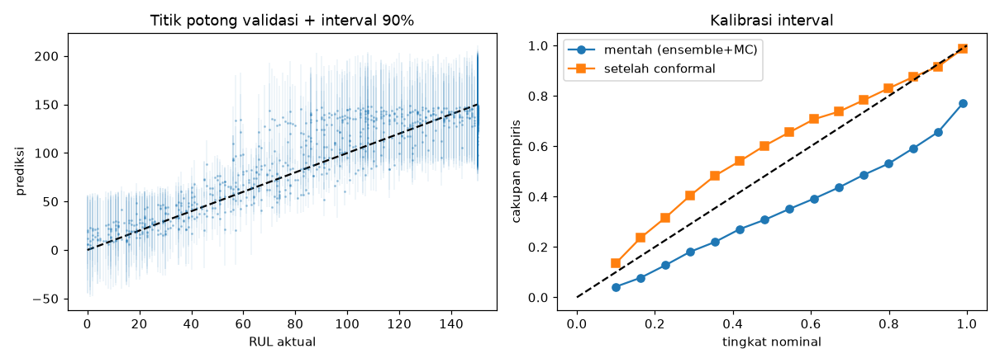<figcaption><b>Gambar 5.</b> Prediksi titik potong fold 0 dengan interval 90% dan kurva kalibrasi sebelum/sesudah conformal. (<code>laporan_figs/task2/uncert_kalibrasi.png</code>)</figcaption></figure>

# Task 3 — Clustering Multimodal: Jenis Material

Penulis bab: Satrio Arjuna Putra. Angka dari `runs/t3_eda`, `runs/t3_ssl_*`, dan `runs/t3_cluster_*`
(`metrics.json`; tabel lengkap di `docs/tabel_laporan.md`).
Task 3 tidak memiliki label; atribut `mikroskop` di meta **tidak** dipakai untuk melatih atau
mengelompokkan, hanya untuk memeriksa apakah representasi/cluster mengikuti faktor pengganggu.

## 3a. Eksplorasi distorsi (`kode/task3_cluster/task3_eda.py`, Gambar `laporan_figs/task3/eda_contoh.png`, `eda_distorsi.png`)

36.000 sampel: citra mikrostruktur grayscale 64×64 dan spektrum 128 titik.

**Citra**

- **Rotasi**: histogram orientasi tekstur (10 bin, 0–180°) hampir merata (1.279–2.486 sampel per bin);
  55,8% sampel memiliki tekstur berarah kuat. Orientasi tersebar ke segala arah, jadi rotasi adalah
  distorsi akuisisi, bukan ciri material.
- **Perbedaan mikroskop**: 60,1% sampel dari M1 (21.636) dan 39,9% dari M2 (14.364). M2 lebih terang
  (kecerahan rata-rata 146,1 vs 127,8) dan lebih tajam (energi Laplacian 20,7 vs 14,7; M1 lebih blur),
  sedangkan kontras (19,7 vs 19,9) dan frekuensi tekstur dominan (5,99 vs 5,97) hampir sama.
- **Skala & kecerahan**: variasi perbesaran dan kecerahan antar sampel (lihat `eda_contoh.png`).

**Spektrum**

- **Spike**: 22,5% spektrum memiliki spike (rata-rata 0,26 spike per spektrum), merata di M1/M2
  (0,259 vs 0,253).
- **Baseline**: kemiringan baseline bervariasi lebar (persentil 5–95%: −0,92 s.d. 0,50).
- **Pergeseran/puncak**: tiap spektrum memiliki beberapa puncak (pengamatan visual `eda_contoh.png`); posisi puncak tertinggi tersebar di indeks 17–80 (persentil 5–95%).
  Sebagian variasi posisi ini mungkin ciri material, sehingga augmentasi pergeseran dibuat kecil (±6 titik).
- Baseline dan spike tidak berbeda antar mikroskop (baseline −0,088 vs −0,092), jadi faktor mikroskop
  terutama memengaruhi citra.

**Kesimpulan distorsi dominan**: citra — rotasi dan perbedaan mikroskop (kecerahan + blur);
spektrum — baseline miring/lengkung dan spike.

## 3b. Representasi tanpa label (`kode/task3_cluster/task3_ssl.py`)

**Metode utama: SimCLR** (Chen dkk., 2020). Dua augmentasi acak dari sampel yang sama dipaksa
berdekatan di ruang embedding (pasangan positif), sampel lain di batch menjadi negatif (loss NT-Xent,
τ = 0,2, batch 512, 100 epoch untuk ketiga varian). Model hanya bisa meminimalkan loss dengan mengabaikan hal yang diubah
augmentasi, sehingga **augmentasi dipilih untuk meniru distorsi pengganggu dari 3a**, bukan perbedaan material:

| Modalitas | Augmentasi | Alasan (temuan 3a) |
|---|---|---|
| Citra | rotasi bebas 0–360° + flip | orientasi tekstur merata → rotasi bukan ciri material |
| Citra | skala 0,75–1,33 + geser ±7,5% lebar citra | variasi perbesaran |
| Citra | kecerahan ±0,6 std, kontras ×0,6–1,4 | M2 lebih terang dari M1 |
| Citra | blur Gaussian σ 0,3–1,5 (50% sampel) + noise | M1 lebih blur dari M2 |
| Spektrum | geser ±6 titik | pergeseran kalibrasi (dibuat kecil agar posisi puncak tetap bermakna) |
| Spektrum | baseline acak: offset + kemiringan + lengkung | kemiringan baseline bervariasi lebar |
| Spektrum | spike sintetis 0–2 titik (amplitudo 2–8) | 22,5% spektrum punya spike |
| Spektrum | skala amplitudo ×0,8–1,2 + noise kecil | variasi intensitas pengukuran |

**Encoder**: CNN 4 blok untuk citra (64×64 → 256-d, global average pooling) dan 1D-CNN 4 blok untuk
spektrum (128 → 256-d); keduanya dilatih dari nol. Embedding = keluaran encoder sebelum projection head.
Embedding citra dirata-rata atas 8 transformasi dihedral (rotasi 90° × flip) agar lebih invarian rotasi.

**Varian yang dibandingkan**

1. `img`: SimCLR citra saja.
2. `spec`: SimCLR spektrum saja.
3. `joint`: kedua encoder dilatih bersama dengan NT-Xent citra + NT-Xent spektrum + kontras lintas
   modalitas (citra_i ↔ spektrum_i, seperti CLIP, bobot 0,5). Jenis material memengaruhi kedua modalitas,
   sedangkan pengganggu (mikroskop, rotasi, baseline) hanya memengaruhi salah satunya; menyelaraskan kedua
   modalitas mendorong embedding menangkap faktor bersama, yaitu material.
4. `pretrained`: ResNet18 bobot ImageNet dari torchvision (He dkk., 2016;
   https://download.pytorch.org/models/resnet18-f37072fd.pth), tanpa fine-tuning, sebagai pembanding.

**Pemilihan representasi tanpa label** (`runs/t3_cluster_banding/banding_representasi.csv`). Label material
tidak ada, jadi representasi dinilai dari **kesepakatan lintas modalitas**: K-Means dijalankan terpisah pada
embedding citra dan embedding spektrum, lalu dihitung ARI di antara keduanya. Jenis material memengaruhi kedua
modalitas, sedangkan pengganggu (mikroskop, rotasi, baseline) hanya memengaruhi salah satunya; representasi yang
lebih menangkap material menghasilkan kesepakatan lebih tinggi (kriteria ini tertulis di docstring
`task3_cluster.py` sebelum run). Pasangan yang dipilih: rata-rata ARI pada k = 6 dan k = 10 tertinggi.

| Citra | Spektrum | ARI k=6 | ARI k=10 | NMI citra–mikroskop (k=6 / 10) |
|---|---|---|---|---|
| SimCLR citra | SimCLR spektrum | 0,5955 | 0,3636 | 0,0000 / 0,0076 |
| **SimCLR citra** | **SimCLR joint (spektrum)** | **0,5955** | **0,3639** | 0,0000 / 0,0076 |
| SimCLR citra | klasik (median + baseline + PCA) | 0,6407 | 0,3125 | 0,0000 / 0,0076 |
| joint (citra) | joint (spektrum) | 0,5957 | 0,3570 | 0,0000 / 0,0067 |
| ResNet18 ImageNet | joint (spektrum) | 0,4700 | 0,3362 | 0,0066 / 0,0138 |

- Encoder citra SimCLR jelas lebih baik daripada ResNet18 ImageNet (bobot ImageNet tidak mengenal tekstur
  mikrostruktur dan tidak invarian rotasi) dan sedikit lebih baik daripada encoder citra hasil `joint`.
- Untuk spektrum, SimCLR spektrum-saja dan SimCLR `joint` praktis setara (selisih 0,0003 di k = 10); aturan memilih
  `joint`. Pembanding klasik unggul di k = 6 tetapi kalah di k = 10.
- NMI terhadap mikroskop ≈ 0: augmentasi kecerahan/blur berhasil membuat embedding tidak peka mikroskop.

**Representasi final**: citra dari `t3_ssl_img_s0`, spektrum dari `t3_ssl_joint_s0`.

## 3c. Dua modalitas dan fusi

Tiap embedding distandardisasi → PCA 32 dimensi → dinormalisasi L2, lalu digabung
`[√w·citra, √(1−w)·spektrum]` dengan w = 0,5 (tiap blok bernorma 1, sehingga bobot kedua modalitas setara).

Hasil pada k = 8 (`runs/t3_cluster_final/metrics.json` → `modality`; Gambar `modality_kontingensi.png`, `umap.png`):

| Ruang | Silhouette | ARI terhadap cluster fusi |
|---|---|---|
| citra saja | 0,2998 | 0,6926 |
| spektrum saja | 0,2524 | 0,7398 |
| ARI citra-saja vs spektrum-saja | | 0,4315 |

**Apa yang hilang jika hanya satu modalitas** (uji belah di 3e dan `contoh_cluster.png`):

- **Hanya citra**: pasangan cluster 2/7 dan 1/6 bertekstur mirip (seluler/berbutir dan garis halus) dan hanya
  berbeda di spektrum, sehingga masing-masing tergabung menjadi satu cluster.
- **Hanya spektrum**: pasangan 0/4 (garis lurus halus vs garis bergelombang kasar) dan 3/5 (bercak gelap vs sel
  terang) memiliki spektrum yang sama, sehingga tidak bisa dipisahkan tanpa citra.
- Fusi memisahkan keempat pasangan itu; inilah alasan ARI citra-saja vs spektrum-saja hanya 0,4315.

## 3d. Clustering: K-Means vs GMM vs DEC

Pada ruang fusi, k = 8 (`runs/t3_cluster_final/metrics.json` → `metode`, `ARI_antar_metode`):

| Metode | Silhouette | Davies-Bouldin | Stabilitas 3 seed (ARI) | NMI mikroskop |
|---|---|---|---|---|
| **K-Means** | **0,2293** | **1,7824** | **1,0000** | 0,0000 |
| GMM (kovarians penuh, PCA 16) | 0,2239 | 1,8152 | 0,8013 | 0,0000 |
| DEC (Xie dkk., 2016; varian IDEC) | 0,2292 | 1,7838 | 0,8835 | 0,0001 |

- **DEC**: autoencoder MLP (64→256→128→16) dilatih rekonstruksi, pusat awal dari K-Means di ruang laten, lalu
  meminimalkan KL(P‖Q) dengan distribusi target yang dipertajam (+0,1 × loss rekonstruksi agar struktur lokal
  terjaga). DEC berhenti setelah 4 iterasi; hasilnya hampir sama dengan inisialisasinya (ARI 0,9942) dan dengan
  K-Means final (ARI 0,9910). Di ruang latennya sendiri cluster DEC jauh lebih rapat (silhouette 0,5105), tetapi
  stabilitas antar seed lebih rendah daripada K-Means.
- **GMM** menggabungkan satu pasangan citra-saja (satu komponen berisi 8.637 sampel) dan membelah pasangan lain;
  ARI terhadap K-Means hanya 0,8164.
- **Metode final**: aturan `--metode auto` (silhouette fusi tertinggi dibulatkan 3 desimal, seri → stabilitas)
  memilih **K-Means** (silhouette seri dengan DEC, stabilitas 1,0000 vs 0,8835). Model deep learning-nya adalah
  encoder SimCLR; K-Means mengelompokkan embedding-nya. `cluster.csv` = K-Means k = 8.

## 3e. Jumlah cluster

Pemindaian k = 2–20 pada ruang fusi (`runs/t3_cluster_k/metrics.json`, Gambar `pilih_k.png`):

| k | Silhouette 64-d | Davies-Bouldin | Stabilitas | Silhouette UMAP | ARI citra vs spektrum |
|---|---|---|---|---|---|
| 4 | 0,2995 | 1,4606 | 1,0000 | 0,6110 | 0,8007 |
| **5** | **0,3155** | **1,3319** | 0,9343 | 0,6544 | **0,8344** |
| 6 | 0,3076 | 1,3767 | 0,8395 | 0,7449 | 0,5955 |
| 7 | 0,2574 | 1,6593 | 0,7768 | **0,8442** | 0,5366 |
| **8** | 0,2293 | 1,7824 | 0,8940 | 0,7872 | 0,4315 |
| 10 | 0,1998 | 1,9042 | 0,9353 | 0,6513 | 0,3639 |

Kriteria memberi jawaban berbeda karena struktur datanya **bertingkat**:

1. **Silhouette (maks) dan Davies-Bouldin (min) di ruang 64-d → k = 5**: ada 5 kelompok kasar yang terpisah jelas.
   BIC GMM terus turun sampai k = 20 (siku di k = 7), jadi BIC tidak informatif di sini.
2. **UMAP**: silhouette di ruang UMAP 2-D maksimum di k = 7, dan graf kNN pada UMAP terdiri dari 7 komponen
   terpisah (sama untuk 10 dan 30 tetangga). Dua dari 5 kelompok kasar ternyata terdiri dari dua pulau.
3. **Uji belah per modalitas** (`runs/t3_cluster_k/uji_belah.csv`): tiap kelompok kasar diproyeksikan ke arah
   2-means di ruang citra dan ruang spektrum secara terpisah, lalu dihitung rasio lembah histogram proyeksinya
   (≈ 0 = dua puncak terpisah, ≈ 1 = satu gumpalan; ambang 0,3).

| Kelompok kasar | n | Lembah citra | Lembah spektrum | Hasil |
|---|---|---|---|---|
| 0 | 10.043 | 1,000 | **0,004** | terbelah, hanya di spektrum → cluster final 2 + 7 |
| 1 | 8.685 | 1,000 | **0,202** | terbelah lemah, di spektrum → cluster final 1 + 6 |
| 2 | 3.656 | 0,972 | 0,440 | satu gumpalan → cluster final 3 |
| 3 | 4.979 | 1,000 | 0,416 | satu gumpalan → cluster final 5 |
| 4 | 8.637 | **0,003** | 0,502 | terbelah, hanya di citra → cluster final 0 + 4 |

Jadi **5 kelompok kasar + 3 yang terbelah = k = 8**. Silhouette 64-d tidak melihatnya karena perbedaan yang hanya
ada di satu modalitas "terencerkan" setengahnya setelah concat, sementara silhouette/DB menyukai cluster bulat yang
terpisah jauh. Pemeriksaan silang: pada k = 8, K-Means dan DEC (dua cara kerja berbeda) menghasilkan partisi yang
hampir identik (ARI 0,9910), dan ke-8 cluster berukuran seimbang (3.656–5.787 sampel).

Catatan proses: kami mula-mula hanya memakai kriteria 64-d (k = 5). UMAP (3f) memperlihatkan pulau-pulau yang
tergabung, sehingga kriteria UMAP dan uji belah ditambahkan ke `kode/task3_cluster/task3_cluster.py` lalu tahap `k` dan `final`
dijalankan ulang. Tidak ada label maupun atribut (mikroskop) yang dipakai dalam keputusan ini.

<figure>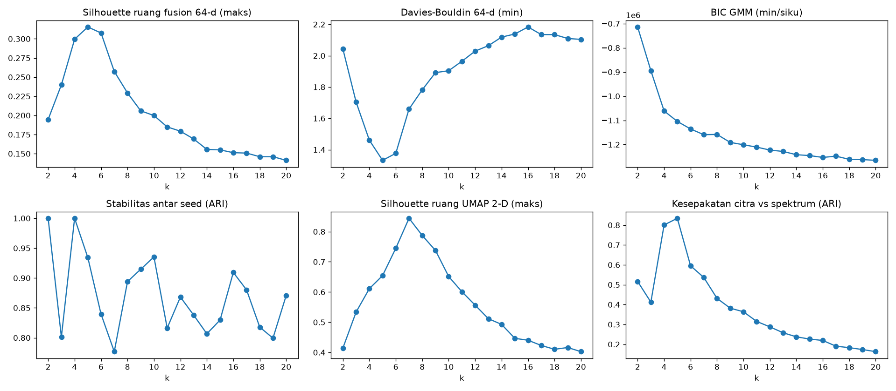<figcaption><b>Gambar 6.</b> Kriteria pemilihan jumlah cluster untuk k = 2–20. (<code>laporan_figs/task3/pilih_k.png</code>)</figcaption></figure>

## 3f. Analisis: UMAP dan cluster yang sulit dipisah

Gambar `umap.png` (UMAP ruang fusi, 30 tetangga) dan `contoh_cluster.png` (6 citra + median spektrum per cluster).

- **Pasangan tersulit: cluster 1 vs 6** (jarak pusat 0,648). Citranya sama-sama garis halus berarah; spektrumnya
  punya tiga puncak di posisi yang sama dan hanya **tinggi relatif dua puncak tengah yang bertukar**. Di UMAP
  keduanya menempel menjadi satu pulau dengan silhouette ≈ 0 di batasnya, dan uji belahnya paling lemah
  (lembah 0,202). Silhouette per cluster: 0,2030 dan 0,1836.
- **Cluster 2 vs 7** (jarak pusat terdekat, 0,538; silhouette terendah 0,1635 dan 0,1480): tekstur
  seluler/berbutir yang mirip, dibedakan oleh spektrum. Di ruang 64-d keduanya berdekatan, tetapi di spektrum
  terpisah tegas (lembah 0,004), sehingga UMAP menampilkannya sebagai dua pulau.
- **Cluster 0 vs 4 dan 3 vs 5**: spektrum identik, dipisahkan oleh citra dengan jelas.
- **Mikroskop bukan penyebab cluster**: proporsi M2 per cluster 0,388–0,407, dan hanya 0,54% sampel yang ambigu
  menurut GMM (posterior cluster kedua > 0,2).

**Keterbatasan**: bukti bahwa cluster 1 dan 6 adalah dua material adalah yang paling lemah di antara ketiga
belahan. Jika keduanya ternyata satu material, k yang tepat adalah 7. ARI terhadap label sebenarnya hanya diketahui
dosen.

<figure>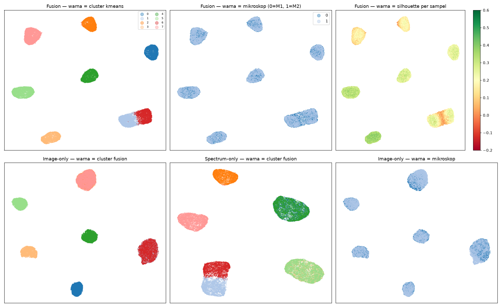<figcaption><b>Gambar 7.</b> UMAP ruang fusi, diwarnai cluster final. (<code>laporan_figs/task3/umap.png</code>)</figcaption></figure>

# Kesimpulan

| Task | Model final | Hasil validasi utama (sumber) |
|---|---|---|
| 1 | Fusi cross-attention + modality dropout 25% + buang kandidat salah label, ensemble 3 seed | macro-F1 0,8700 ± 0,0012; tertimbang komposisi test 0,8286 ± 0,0015 (`runs/t1_tabel/final_mean_std.csv`) |
| 2 | GRU 2 lapis, W = 50, ensemble 5 seed + MC dropout, interval conformal | RMSE 19,54, skor asimetris 21,60 per titik (`runs/t2_cv_gru`); cakupan interval 90,3% (`runs/t2_uncert_gru`) |
| 3 | SimCLR (citra) + SimCLR joint (spektrum), fusi, K-Means k = 8 | silhouette 0,2293, stabilitas 3 seed 1,0000 (`runs/t3_cluster_final`) |

**Temuan utama.**

1. **Fusi multimodal diperlukan.** Pada Task 1, tiap modalitas hanya mengenali sebagian kelas (`las_dingin`
   hanya terlihat di sensor, `kontaminasi`/`noda`/`gores` hanya di gambar). Fusi menaikkan macro-F1 dari 0,687
   (gambar saja) ke 0,844. Pada Task 3, citra-saja dan spektrum-saja masing-masing menggabungkan pasangan
   material yang berbeda (ARI antara keduanya 0,4315). Hanya fusi yang memisahkan kedelapan cluster.
2. **Preprocessing dan validasi yang tepat lebih menentukan daripada arsitektur.** Pada Task 2, normalisasi
   per regime adalah syarat agar tren degradasi terlihat. Resep training yang ter-regularisasi menurunkan RMSE
   GRU dari 24,19 ke 19,54, sedangkan selisih antar arsitektur hanya 19,54–20,65. Pada Task 1, modality dropout
   menaikkan skor bahkan saat sensor lengkap (0,8440 → 0,8692).
3. **Ketidakpastian harus dikalibrasi.** Interval dari MC dropout dan ensemble hanya mencakup 62,2% (target
   90%). Split-conformal memperbaikinya menjadi 90,3%, dan interval itu menjadi dasar aturan servis
   "batas bawah 90% ≤ 30 siklus".

**Keterbatasan.**

- **Task 1**: celah antara lini A dan B (0,899 vs 0,780) belum teratasi. Tidak ada teknik domain yang kami uji
  yang menaikkan lini B, padahal lini B mencakup 60% data uji. Skor uji kemungkinan lebih dekat ke estimasi
  tertimbang (±0,83).
- **Task 2**: semua model lemah di rentang RUL 50–100 (RMSE ±29,5, cakupan interval 72,3%). Resep training
  dipilih di fold 0, sehingga estimasi CV sedikit optimis. Pergeseran prediksi untuk menurunkan skor asimetris
  sengaja tidak dipakai karena akan menaikkan RMSE.
- **Task 3**: bukti bahwa pasangan cluster 1 dan 6 adalah dua material berbeda paling lemah. Jika keduanya
  satu material, k yang tepat adalah 7.
- **Umum**: label validasi Task 1 sendiri berasal dari inspektur dan ikut mengandung noise. Sebagian
  eksperimen pembanding hanya dijalankan dengan satu seed, sehingga selisih kecil sebaiknya dibaca sebagai
  setara.

# Daftar Pustaka

- Angelopoulos, A. N., Bates, S. (2021). A Gentle Introduction to Conformal Prediction and Distribution-Free Uncertainty Quantification. arXiv:2107.07511.
- Bai, S., Kolter, J. Z., Koltun, V. (2018). An Empirical Evaluation of Generic Convolutional and Recurrent Networks for Sequence Modeling. arXiv:1803.01271.
- Chen, T., Kornblith, S., Norouzi, M., Hinton, G. (2020). A Simple Framework for Contrastive Learning of Visual Representations. ICML.
- Cho, K. dkk. (2014). Learning Phrase Representations using RNN Encoder–Decoder for Statistical Machine Translation. EMNLP.
- Gal, Y., Ghahramani, Z. (2016). Dropout as a Bayesian Approximation: Representing Model Uncertainty in Deep Learning. ICML.
- He, K., Zhang, X., Ren, S., Sun, J. (2016). Deep Residual Learning for Image Recognition. CVPR.
- Ke, G. dkk. (2017). LightGBM: A Highly Efficient Gradient Boosting Decision Tree. NeurIPS.
- Lakshminarayanan, B., Pritzel, A., Blundell, C. (2017). Simple and Scalable Predictive Uncertainty Estimation using Deep Ensembles. NeurIPS.
- McInnes, L., Healy, J., Melville, J. (2018). UMAP: Uniform Manifold Approximation and Projection for Dimension Reduction. arXiv:1802.03426.
- Radford, A. dkk. (2021). Learning Transferable Visual Models From Natural Language Supervision (CLIP). ICML.
- Saxena, A., Goebel, K., Simon, D., Eklund, N. (2008). Damage Propagation Modeling for Aircraft Engine Run-to-Failure Simulation. PHM 2008 (asal skor asimetris dan RUL ber-cap).
- Vaswani, A. dkk. (2017). Attention Is All You Need. NeurIPS.
- Xie, J., Girshick, R., Farhadi, A. (2016). Unsupervised Deep Embedding for Clustering Analysis. ICML.

# Lampiran A. Gambar pendukung

Gambar yang dirujuk di teks dengan nama filenya. Tabel lengkap seluruh angka eksperimen ada di `docs/tabel_laporan.md` (dibuat otomatis oleh `kode/tabel_laporan.py`).

<figure>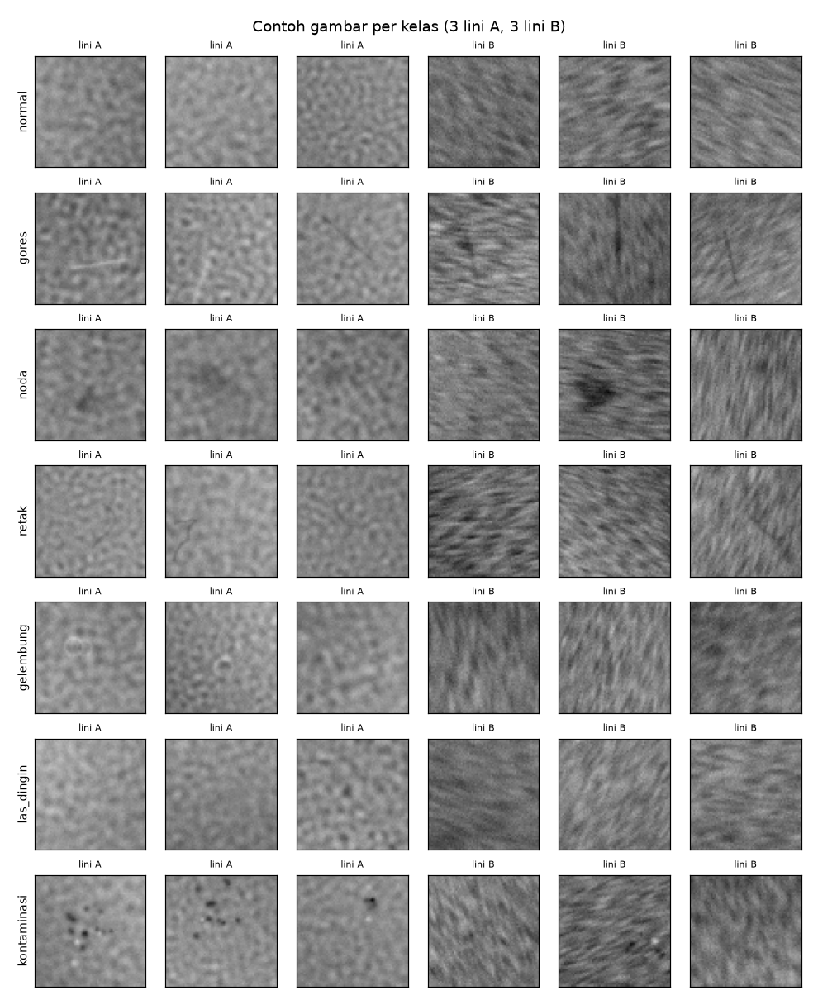<figcaption><b>Gambar 8.</b> Task 1 — eda contoh gambar. (<code>laporan_figs/task1/eda_contoh_gambar.png</code>)</figcaption></figure>

<figure>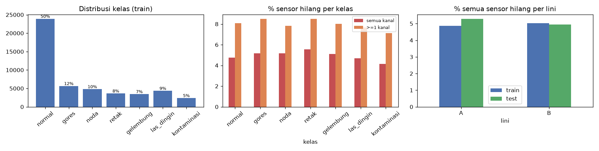<figcaption><b>Gambar 9.</b> Task 1 — eda distribusi. (<code>laporan_figs/task1/eda_distribusi.png</code>)</figcaption></figure>

<figure>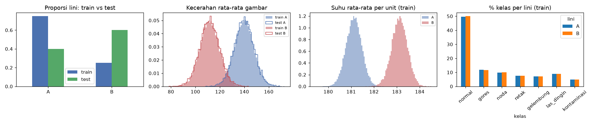<figcaption><b>Gambar 10.</b> Task 1 — eda shift lini. (<code>laporan_figs/task1/eda_shift_lini.png</code>)</figcaption></figure>

<figure>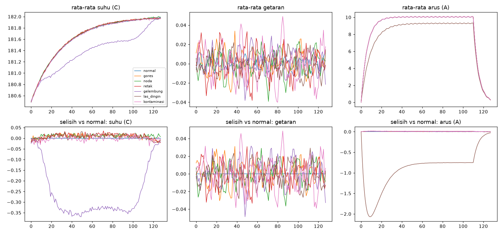<figcaption><b>Gambar 11.</b> Task 1 — eda sinyal per kelas. (<code>laporan_figs/task1/eda_sinyal_per_kelas.png</code>)</figcaption></figure>

<figure>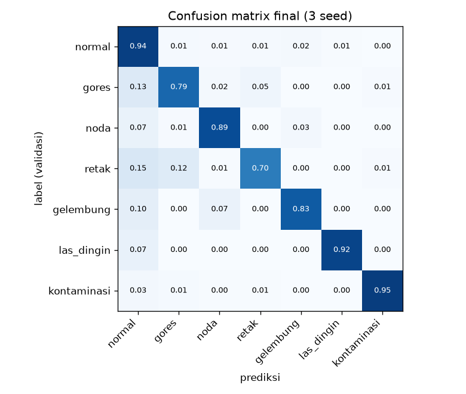<figcaption><b>Gambar 12.</b> Task 1 — final confusion. (<code>laporan_figs/task1/final_confusion.png</code>)</figcaption></figure>

<figure>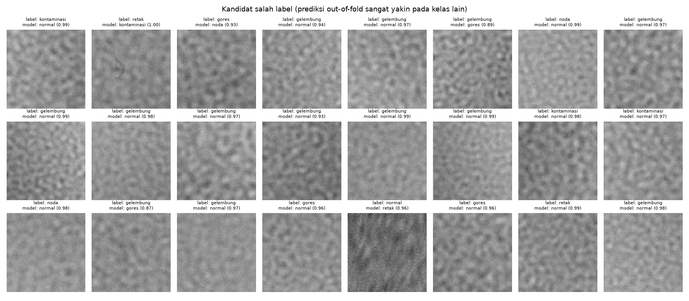<figcaption><b>Gambar 13.</b> Task 1 — noise contoh. (<code>laporan_figs/task1/noise_contoh.png</code>)</figcaption></figure>

<figure>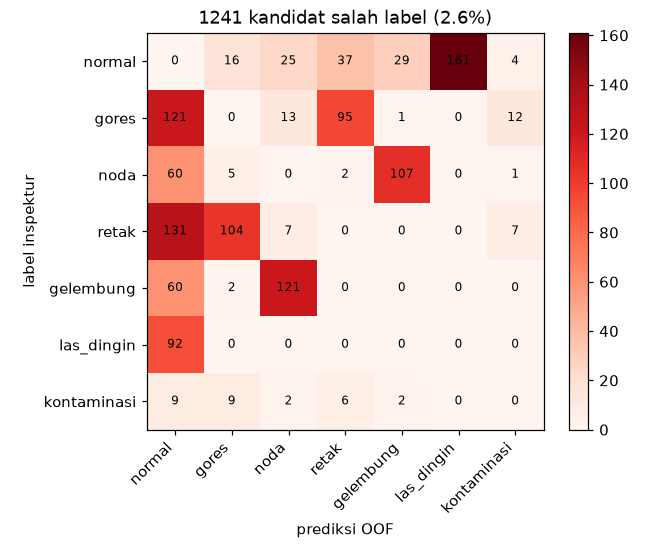<figcaption><b>Gambar 14.</b> Task 1 — noise matriks. (<code>laporan_figs/task1/noise_matriks.png</code>)</figcaption></figure>

<figure>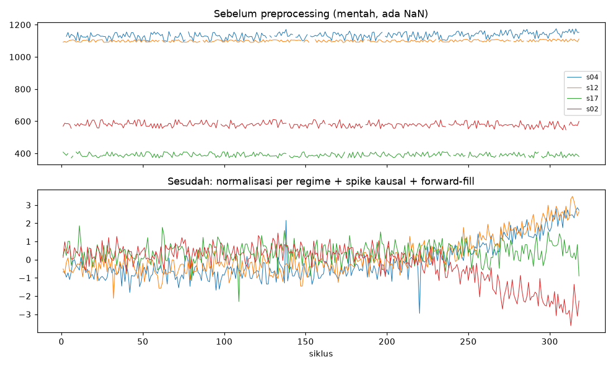<figcaption><b>Gambar 15.</b> Task 2 — eda contoh mesin. (<code>laporan_figs/task2/eda_contoh_mesin.png</code>)</figcaption></figure>

<figure>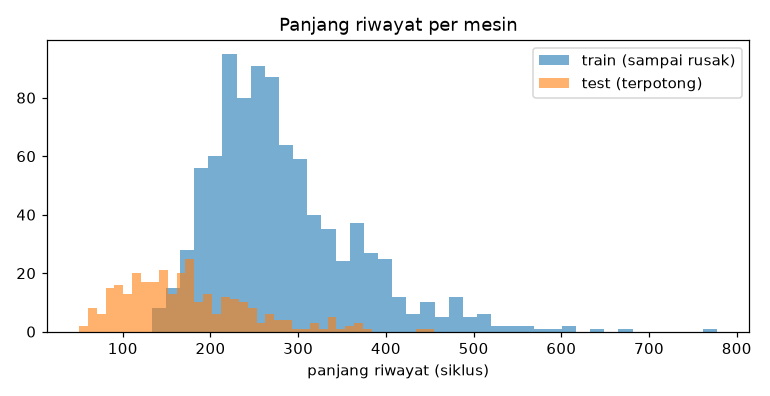<figcaption><b>Gambar 16.</b> Task 2 — eda panjang. (<code>laporan_figs/task2/eda_panjang.png</code>)</figcaption></figure>

<figure>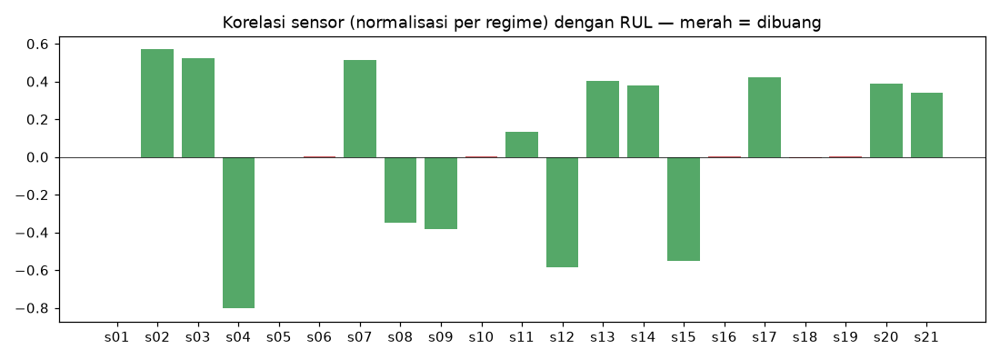<figcaption><b>Gambar 17.</b> Task 2 — eda sensor. (<code>laporan_figs/task2/eda_sensor.png</code>)</figcaption></figure>

<figure>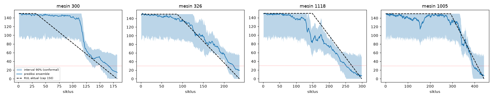<figcaption><b>Gambar 18.</b> Task 2 — uncert lintasan. (<code>laporan_figs/task2/uncert_lintasan.png</code>)</figcaption></figure>

<figure>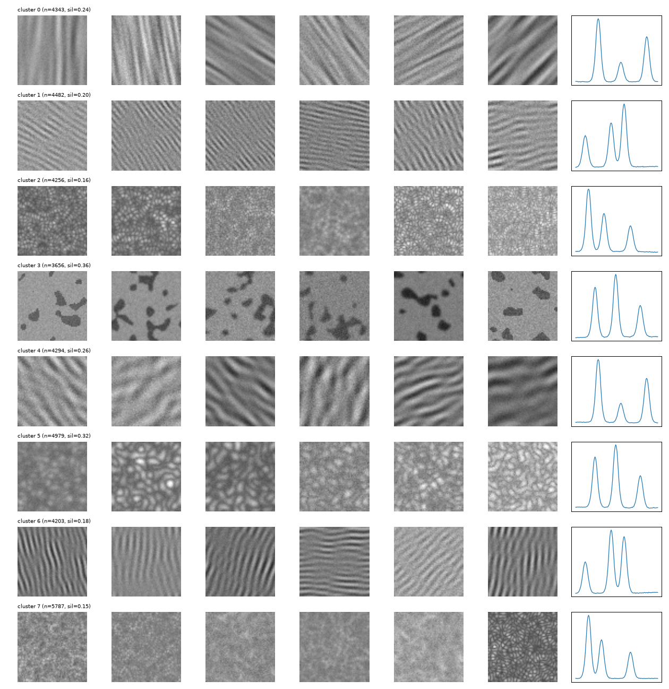<figcaption><b>Gambar 19.</b> Task 3 — contoh cluster. (<code>laporan_figs/task3/contoh_cluster.png</code>)</figcaption></figure>

<figure>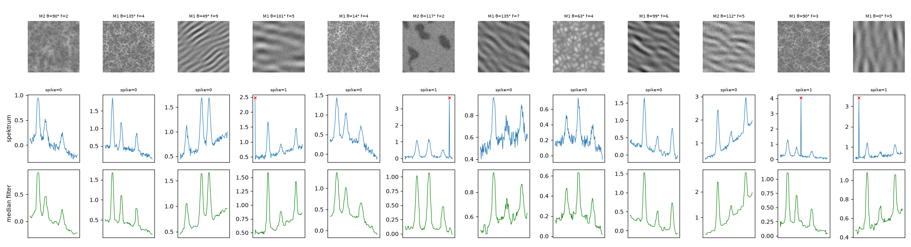<figcaption><b>Gambar 20.</b> Task 3 — eda contoh. (<code>laporan_figs/task3/eda_contoh.png</code>)</figcaption></figure>

<figure>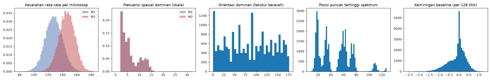<figcaption><b>Gambar 21.</b> Task 3 — eda distorsi. (<code>laporan_figs/task3/eda_distorsi.png</code>)</figcaption></figure>

<figure>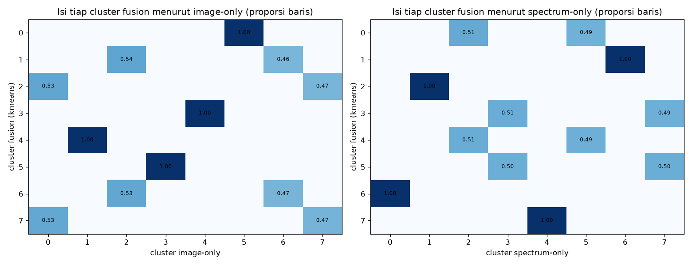<figcaption><b>Gambar 22.</b> Task 3 — modality kontingensi. (<code>laporan_figs/task3/modality_kontingensi.png</code>)</figcaption></figure>

